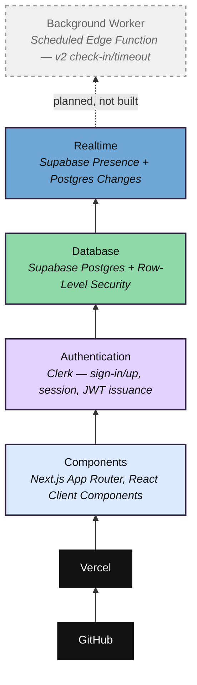
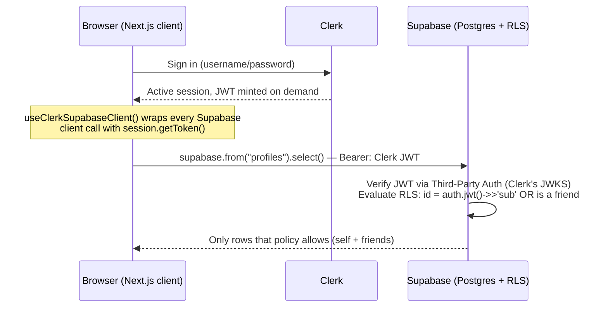
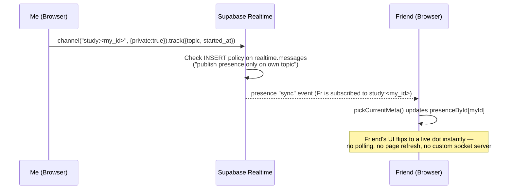
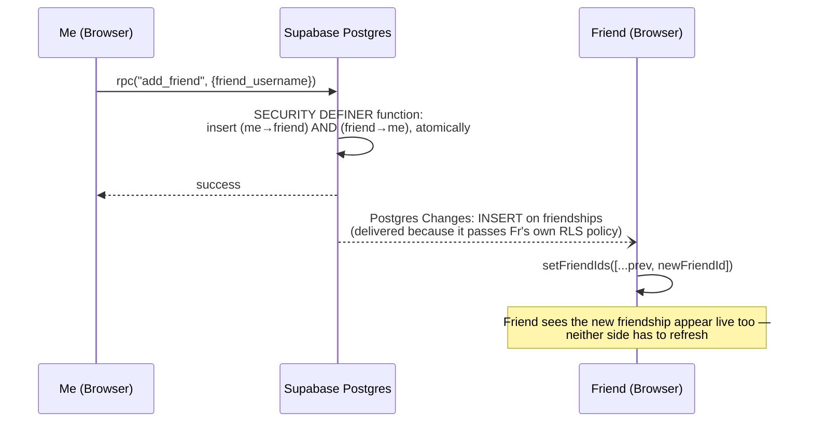

# Study-Hub

A social study-presence app: create an account, add friends, and start a "study session" that shows friends a live green dot plus what you're working on ("CS 151 PSET — started 12 min ago"). No polling, no refresh button — friends see you go live and go idle in real time.

Full product spec (problem, users, UI decisions, roadmap, deadlines) lives in [`index.html`](./index.html). **This README is the companion engineering doc** — it explains what's actually running under the hood, and why, for the course's **Systems** depth track (data model, background work, real-time updates, and the services it connects to — see the four-quadrant rubric below).

| Holistic Journey | Design | **Systems (this doc)** | AI |
|---|---|---|---|
| Most topics, least depth | Interface polish, states, accessibility | **Data model, background work, realtime, service wiring** | Model calls, tools, evals |

This project puts its depth into the Systems column. The sections below walk through what's built, in the order you'd trace a request through the system.

---

## 1. The stack, layer by layer

Three managed services, wired together by passing one signed token between them — no custom backend server in between.



Reading it bottom-up mirrors how the project was actually built: deploy infra first, then UI, then auth, then a database, then realtime — with one layer (**scheduled background work**) still missing. That gap is called out deliberately; see [§5](#5-whats-built-vs-whats-not-the-honest-systems-checklist).

---

## 2. Tracing three requests through the system

### a) Signing in and loading your data



Supabase never sees a password or an email — only a signed JWT it independently verifies against Clerk's public keys (Supabase's "Third-Party Auth" integration, *not* the older JWT-template approach, which required mirroring claims by hand on both sides).

### b) Starting a study session (realtime presence)



Closing the tab or losing the connection needs no extra code: Presence's native "leave" event fires automatically, and the friend's `sync` handler clears that entry on its own.

### c) Adding a friend



---

## 3. The data model

Two tables, both guarded by row-level security:

```sql
create table profiles (
  id text primary key,          -- Clerk user.id ("user_2abc..."), NOT a uuid
  username text unique not null,
  created_at timestamptz not null default now()
);

create table friendships (
  user_id text references profiles(id) on delete cascade,
  friend_id text references profiles(id) on delete cascade,
  created_at timestamptz not null default now(),
  primary key (user_id, friend_id)
);
```

Three choices worth understanding, not just copying:

- **`id` is `text`, not `uuid`.** Supabase's usual pattern checks `auth.uid()`, which assumes Supabase's own auth generates the user id as a uuid. Clerk generates its own string ids, so every policy here reads `auth.jwt()->>'sub'` directly instead — the correct substitution once a third-party identity provider owns the id.
- **Friendship is symmetric, stored as two rows,** so "who are my friends" is always a plain `select ... where user_id = me` with no join or union. The cost: both directions have to be kept in sync on every add/remove.
- **No INSERT/DELETE policy on `friendships` at all.** A naive insert policy (`with check (user_id = auth.jwt()->>'sub')`) would let you write your own half of the row but not the other person's — you'd need a second, trusted write to complete the pair, and RLS alone can't express "and also write this other row atomically." Instead, both directions are written inside one `security definer` Postgres function (`add_friend`/`remove_friend`), so the only way to mutate the table at all is through logic that's already been audited to keep both sides consistent.

Realtime has its own, parallel authorization layer — RLS policies on Supabase's internal `realtime.messages` table decide who can `track` (publish) or `subscribe` (read) a given presence topic. This is enforced **on Supabase's servers**, not just by which channels the client UI happens to subscribe to — opening devtools and guessing a stranger's channel name doesn't work, because the read policy still requires an existing `friendships` row.

---

## 4. Why these choices (the tradeoffs, not just the picks)

| Decision | Why | Tradeoff accepted |
|---|---|---|
| Clerk for identity, Supabase for data | Clerk's Third-Party Auth integration lets Supabase verify Clerk's JWT directly — no shared secret, no claims-mirroring JWT template to keep in sync by hand | Two vendor dashboards instead of one; an outage in either one breaks the whole login path |
| Supabase Realtime **Presence**, not polling or a custom WebSocket server | Presence is push-based and reuses the exact same auth/RLS model as the rest of the app; "going offline" is a native event (socket close), not something hand-rolled | Presence state is **ephemeral** — it lives in Supabase's realtime server memory, not Postgres (see the gap called out in [§5](#5-whats-built-vs-whats-not-the-honest-systems-checklist)) |
| Private channels + Realtime Authorization policies, not public channels filtered client-side | A public channel is readable by anyone who can guess its name, regardless of what the UI shows — this fails the "actual security, not security theater" bar | More setup: every topic needs its own read/write policy, reasoned about like any other table |
| Mutual add, no request/accept step | Simplest possible v1 data model — no "pending" state to track or expire | No consent gate before being added; acceptable for a closed, instructor-described trust group, revisit if the app ever opens up |
| `security definer` RPCs instead of direct table writes | The two-row atomic write literally cannot be expressed as one row's RLS check (see §3) | Every new mutation on `friendships` has to be added as a new audited function, not a quick insert policy |
| Username/password, no email on file | Explicit privacy decision (see `index.html`) | No account-recovery-via-email path exists yet — flagged as an open question there, still unresolved |

---

## 5. What's built vs. what's not (the honest systems checklist)

The course's Systems rubric names four things to go deep on. Here's where each one actually stands:

- ✅ **Data model** — `profiles` + `friendships`, RLS-first, atomic mutual writes (§3)
- ✅ **Real-time updates** — Presence for live status, Postgres Changes for live friend-list updates (§2b, §2c)
- ✅ **Services it connects to** — Clerk and Supabase aren't just both "turned on"; a token minted by one is independently verified by the other on every request (§2a)
- ❌ **Background work — not built yet.** This is the single biggest remaining piece, and it's the one the rubric explicitly names. The v2 check-in/timeout state machine (30-min check-in, 10-min grace period, auto-timeout to red) needs a scheduled job, and none exists yet.

`index.html` already has written guardrails for that job (narrow `WHERE` clauses, no full-table fetch-to-diff, match polling interval to how fast the data actually changes, watch usage on day one) — written specifically *because* an unrelated course project burned through a Supabase account's egress quota with a cron job that re-read entire tables every run. Those rules are binding for whoever builds this next.

---

## 6. Open questions (worth answering before building the background worker)

- **Where does the check-in job actually read from?** Presence state currently lives only in Supabase Realtime's in-memory server state — it is never written to Postgres. But the guardrails in `index.html` assume a query like `WHERE status = 'active' AND started_at < now() - interval '30 minutes'`, which only works against a **table**. Right now there is no `sessions` table at all (the original roadmap mentioned one; it was never built). This has to be resolved before the background worker can exist: either presence needs to start writing through to Postgres on every `track()` call, or the check-in job needs some other way to see session state.
- **Multi-tab / multi-device presence:** one Clerk user currently maps to exactly one presence key (`user.id`) per channel. If the same account is open on a phone and a laptop at once, does the second `track()` overwrite the first, and is that the intended behavior?
- **The reconnect grace window (v2):** Presence's `sync`/leave events are immediate — there's no native "briefly disconnected" state. The v2 spec wants a 1–2 minute grace window before a drop counts as a real disconnect. That intermediate state will need to be built on top of Presence, not read directly from it — worth sketching before starting that work.
- **Friend-request consent:** mutual add with no accept step was a deliberate v1 simplification (§4). Is that still the right call for v2, or does profile/session visibility change that calculus?
