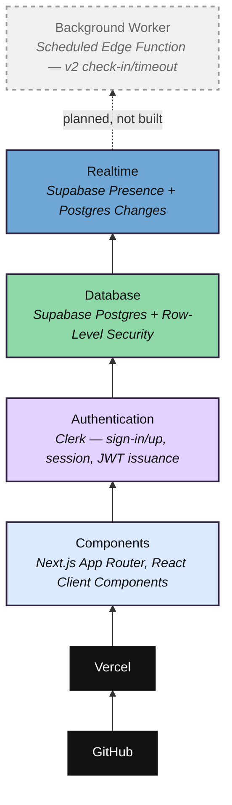
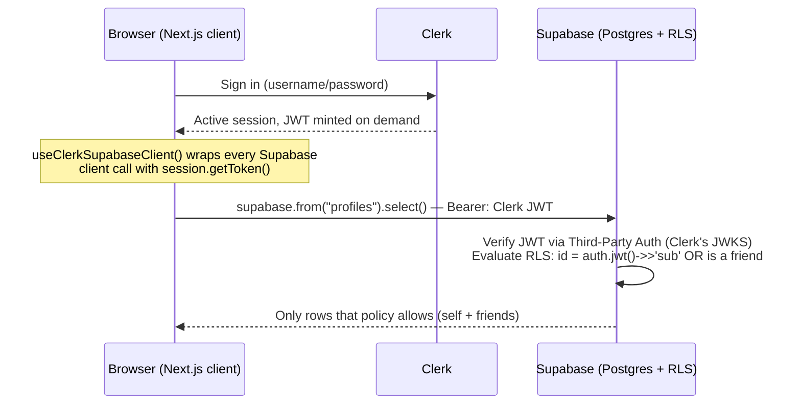
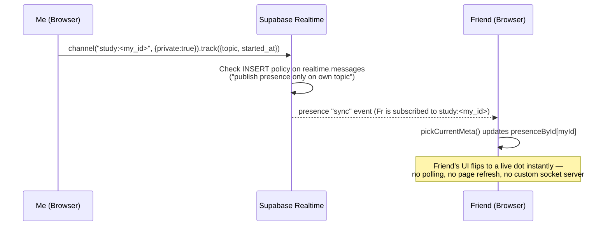
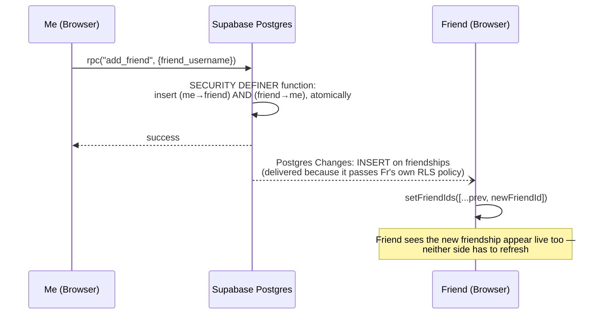

# Study-Hub

A social study-presence app: create an account, add friends, and start a "study session" that shows friends a live green dot plus what you're working on ("CS 151 PSET — started 12 min ago"). No polling, no refresh button — friends see you go live and go idle in real time.

Full product spec (problem, users, UI decisions, roadmap, deadlines) lives in [`index.html`](./index.html). **This README is the companion engineering doc** — it explains what's actually running under the hood, and why, for the course's **Systems** depth track (data model, background work, real-time updates, and the services it connects to — see the four-quadrant rubric below).

| Holistic Journey | Design | **Systems (this doc)** | AI |
|---|---|---|---|
| Most topics, least depth | Interface polish, states, accessibility | **Data model, background work, realtime, service wiring** | Model calls, tools, evals |

This project puts its depth into the Systems column. The sections below walk through what's built, in the order you'd trace a request through the system.

---

## 1. The stack, layer by layer

Three managed services, wired together by passing one signed token between them — no custom backend server in between.



Reading it bottom-up mirrors how the project was actually built: deploy infra first, then UI, then auth, then a database, then realtime — with one layer (**scheduled background work**) still missing. That gap is called out deliberately; see [§5](#5-whats-built-vs-whats-not-the-honest-systems-checklist).

---

## 2. Tracing three requests through the system

### a) Signing in and loading your data



Supabase never sees a password or an email — only a signed JWT it independently verifies against Clerk's public keys (Supabase's "Third-Party Auth" integration, *not* the older JWT-template approach, which required mirroring claims by hand on both sides).

**Under the hood:**
- A JWT is three base64url segments — `header.payload.signature`. Clerk signs the payload asymmetrically (private key, RS256-family) and publishes the matching *public* key at a well-known JWKS endpoint (standard OIDC federation). Supabase fetches that public key itself and verifies the signature locally — there is no shared secret sitting in either codebase, and nothing Clerk-side has to "trust" Supabase with.
- "Supabase" is not one process. `supabase.from("profiles").select()` goes to **PostgREST** (a service that turns REST calls into SQL), while the presence/changes calls in (b) and (c) go to a completely separate **Realtime** service. Both sit in front of the same Postgres, but over different protocols (HTTP vs. WebSocket), with different scaling characteristics.
- `auth.jwt()->>'sub'` isn't magic — PostgREST verifies the JWT once per request, then sets its claims as a **session-local Postgres variable** for that one transaction; `auth.jwt()` is just a SQL function reading that variable back. The key systems point: RLS is not an application-layer filter bolted on after the query runs — it's a predicate the Postgres **query planner** folds directly into the query itself. A bug in the React code literally cannot leak a row the policy disallows, because the database engine refuses to produce that row in the first place. That's a stronger guarantee than "the UI happens to hide it."
- PostgREST talks to Postgres through a connection pooler (Supavisor/pgbouncer), because Postgres can't cheaply hold thousands of raw idle connections. Each REST call is short-lived and pooled — contrast with (b), where every client holds one long-lived connection open the whole session.

### b) Starting a study session (realtime presence)



Closing the tab or losing the connection needs no extra code: Presence's native "leave" event fires automatically, and the friend's `sync` handler clears that entry on its own.

**Under the hood:**
- This is a different transport than (a): one long-lived, full-duplex **WebSocket** connection per client (opened via an HTTP `Upgrade` handshake), not a sequence of short request/response calls. The connection stays open for the whole session, and both sides can push at any time.
- Supabase Realtime is an Elixir/Phoenix service running on the BEAM VM, and Presence specifically is **Phoenix Presence** — internally it behaves like a CRDT (conflict-free replicated data type): nodes merge join/leave *diffs* rather than consulting one authoritative in-memory table. Practically, this means a client can legitimately see more than one meta entry under the same presence key for a moment during a reconnect or cluster rebalance. `pickCurrentMeta()` in `page.tsx` isn't defensive styling — it exists because the protocol's delivery semantics genuinely allow that duplicate state to appear, however briefly.
- `{ private: true }` means every subscribe attempt — and in practice every tracked message — triggers a live round-trip from the Realtime server back to Postgres to re-evaluate the RLS policy on `realtime.messages`. The systems implication: Realtime is **not actually independent of the database.** If Postgres is slow or unavailable, presence updates slow down or stall too, even though conceptually "a friend went green" feels like it shouldn't need the database at all.
- Delivery is **at-least-once**, not exactly-once — a reconnect can redeliver a `sync` event the client already processed. Code that assumes "sync only ever fires once per real state change" will eventually misbehave; the client has to treat each `sync` as "here is the current truth," not "something changed."

### c) Adding a friend



**Under the hood:**
- `security definer` is Postgres's version of a setuid binary: the function executes with its **owner's** privileges, not the caller's. That's the only reason an authenticated user — who has no `INSERT` grant on `friendships` at all — can still cause two rows to be written. This is real privilege escalation, which is exactly why `set search_path = public` in the function definition isn't boilerplate: without pinning it, a caller could get Postgres to resolve an unqualified name (a table or function the code references by bare name) against a schema *they* control first, hijacking the definer's elevated privileges to run arbitrary code as the function's owner. This is a named, documented Postgres vulnerability class ("search_path injection"), not a hypothetical.
- Both inserts run inside the single implicit transaction of one PL/pgSQL function call — Postgres's **atomicity** guarantee means if the second insert fails, the first is rolled back too. There's no window where a crash mid-function leaves a one-directional "ghost" friendship behind. `on conflict do nothing` adds **idempotency** on top: calling `add_friend` twice (e.g., a retried request after a dropped connection) is safe — no duplicate row, no error.
- Postgres Changes is a fundamentally different delivery mechanism than Presence in (b): it's powered by Postgres's **write-ahead log (WAL)** via logical replication. The Realtime server is a logical-replication subscriber to the `supabase_realtime` publication — it decodes *committed* WAL entries into row-level change events, then checks each one against the receiving client's RLS policy before forwarding it. The distinction worth internalizing: Postgres Changes is durable and derived from the actual committed table — it is physically incapable of telling a client about a friendship that doesn't exist in the database — while Presence (b) is a purely in-memory, ephemeral broadcast that Postgres never sees or stores. That line is exactly where the "no `sessions` table" gap in §6 lives: presence sits on the side of this boundary that a scheduled SQL job can't query.

---

## 3. The data model

Two tables, both guarded by row-level security:

```sql
create table profiles (
  id text primary key,          -- Clerk user.id ("user_2abc..."), NOT a uuid
  username text unique not null,
  created_at timestamptz not null default now()
);

create table friendships (
  user_id text references profiles(id) on delete cascade,
  friend_id text references profiles(id) on delete cascade,
  created_at timestamptz not null default now(),
  primary key (user_id, friend_id)
);
```

Three choices worth understanding, not just copying:

- **`id` is `text`, not `uuid`.** Supabase's usual pattern checks `auth.uid()`, which assumes Supabase's own auth generates the user id as a uuid. Clerk generates its own string ids, so every policy here reads `auth.jwt()->>'sub'` directly instead — the correct substitution once a third-party identity provider owns the id.
- **Friendship is symmetric, stored as two rows,** so "who are my friends" is always a plain `select ... where user_id = me` with no join or union. The cost: both directions have to be kept in sync on every add/remove.
- **No INSERT/DELETE policy on `friendships` at all.** A naive insert policy (`with check (user_id = auth.jwt()->>'sub')`) would let you write your own half of the row but not the other person's — you'd need a second, trusted write to complete the pair, and RLS alone can't express "and also write this other row atomically." Instead, both directions are written inside one `security definer` Postgres function (`add_friend`/`remove_friend`), so the only way to mutate the table at all is through logic that's already been audited to keep both sides consistent.

Realtime has its own, parallel authorization layer — RLS policies on Supabase's internal `realtime.messages` table decide who can `track` (publish) or `subscribe` (read) a given presence topic. This is enforced **on Supabase's servers**, not just by which channels the client UI happens to subscribe to — opening devtools and guessing a stranger's channel name doesn't work, because the read policy still requires an existing `friendships` row.

---

## 4. Why these choices (the tradeoffs, not just the picks)

| Decision | Why | Tradeoff accepted |
|---|---|---|
| Clerk for identity, Supabase for data | Clerk's Third-Party Auth integration lets Supabase verify Clerk's JWT directly — no shared secret, no claims-mirroring JWT template to keep in sync by hand | Two vendor dashboards instead of one; an outage in either one breaks the whole login path |
| Supabase Realtime **Presence**, not polling or a custom WebSocket server | Presence is push-based and reuses the exact same auth/RLS model as the rest of the app; "going offline" is a native event (socket close), not something hand-rolled | Presence state is **ephemeral** — it lives in Supabase's realtime server memory, not Postgres (see the gap called out in [§5](#5-whats-built-vs-whats-not-the-honest-systems-checklist)) |
| Private channels + Realtime Authorization policies, not public channels filtered client-side | A public channel is readable by anyone who can guess its name, regardless of what the UI shows — this fails the "actual security, not security theater" bar | More setup: every topic needs its own read/write policy, reasoned about like any other table |
| Mutual add, no request/accept step | Simplest possible v1 data model — no "pending" state to track or expire | No consent gate before being added; acceptable for a closed, instructor-described trust group, revisit if the app ever opens up |
| `security definer` RPCs instead of direct table writes | The two-row atomic write literally cannot be expressed as one row's RLS check (see §3) | Every new mutation on `friendships` has to be added as a new audited function, not a quick insert policy |
| Username/password, no email on file | Explicit privacy decision (see `index.html`) | No account-recovery-via-email path exists yet — flagged as an open question there, still unresolved |

---

## 5. What's built vs. what's not (the honest systems checklist)

The course's Systems rubric names four things to go deep on. Here's where each one actually stands:

- ✅ **Data model** — `profiles` + `friendships`, RLS-first, atomic mutual writes (§3)
- ✅ **Real-time updates** — Presence for live status, Postgres Changes for live friend-list updates (§2b, §2c)
- ✅ **Services it connects to** — Clerk and Supabase aren't just both "turned on"; a token minted by one is independently verified by the other on every request (§2a)
- ❌ **Background work — not built yet.** This is the single biggest remaining piece, and it's the one the rubric explicitly names. The v2 check-in/timeout state machine (30-min check-in, 10-min grace period, auto-timeout to red) needs a scheduled job, and none exists yet.

`index.html` already has written guardrails for that job (narrow `WHERE` clauses, no full-table fetch-to-diff, match polling interval to how fast the data actually changes, watch usage on day one) — written specifically *because* an unrelated course project burned through a Supabase account's egress quota with a cron job that re-read entire tables every run. Those rules are binding for whoever builds this next.

---

## 6. Open questions (worth answering before building the background worker)

- **Where does the check-in job actually read from?** Presence state currently lives only in Supabase Realtime's in-memory server state — it is never written to Postgres. But the guardrails in `index.html` assume a query like `WHERE status = 'active' AND started_at < now() - interval '30 minutes'`, which only works against a **table**. Right now there is no `sessions` table at all (the original roadmap mentioned one; it was never built). This has to be resolved before the background worker can exist: either presence needs to start writing through to Postgres on every `track()` call, or the check-in job needs some other way to see session state.
- **Multi-tab / multi-device presence:** one Clerk user currently maps to exactly one presence key (`user.id`) per channel. If the same account is open on a phone and a laptop at once, does the second `track()` overwrite the first, and is that the intended behavior?
- **The reconnect grace window (v2):** Presence's `sync`/leave events are immediate — there's no native "briefly disconnected" state. The v2 spec wants a 1–2 minute grace window before a drop counts as a real disconnect. That intermediate state will need to be built on top of Presence, not read directly from it — worth sketching before starting that work.
- **Friend-request consent:** mutual add with no accept step was a deliberate v1 simplification (§4). Is that still the right call for v2, or does profile/session visibility change that calculus?

---

## 7. Additional holes (things a reviewer would probe that aren't design decisions, just gaps)

These are smaller than §6, but real — the kind of thing a code review or an interviewer would flag.

**Security**
- **Username enumeration.** `add_friend` returns a distinguishable error — `"no user with that username"` — when a username doesn't exist, versus silent success when it does. That asymmetry lets anyone probe which usernames exist by trying candidates against the RPC. The fix is standard: make the failure and success paths indistinguishable, or rate-limit the function.
- **No rate limiting on `add_friend` / `remove_friend`.** Nothing stops a client from looping over a wordlist of usernames calling the RPC repeatedly. `security definer` functions are already an elevated attack surface (§2c) — pairing that with zero throttling at the DB or app layer is worth closing before this is exposed beyond a closed class roster.
- **Widened clock-skew tolerance.** `proxy.ts` widens Clerk's token-expiry tolerance to 5 minutes, noted in a comment as a workaround for the dev machine's clock being wrong. That's a real trade: it also widens the window in which an expired or replayed token is still accepted. Worth explicitly deciding whether that ships to production or is dev-only.
- **Username case sensitivity.** Postgres `unique` is case-sensitive by default, so `"Alice"` and `"alice"` can be registered as two different accounts — not what a "search for your friend's username" flow probably intends.

**Data & schema**
- **No migration history.** `schema.sql` is a single script meant to be pasted into the SQL editor once. There's no record of how the schema has changed over time, no reproducible way to stand up a fresh environment from scratch, and no rollback path if a future change (e.g., adding the `sessions` table from §6) breaks something. Worth moving to versioned `supabase migration` files before the next schema change.
- **No cleanup on account deletion.** If a Clerk account is deleted, nothing removes or flags the matching `profiles` row — it becomes an orphaned record, with `friendships` rows still pointing at an identity that no longer exists anywhere else in the system.

**Scaling & reliability**
- **One WebSocket channel per friend, plus one for yourself (N+1).** This is fine at classroom scale, but it doesn't stay flat as a friend list grows — a single shared "my friends' presence" channel would scale differently (and would need a different authorization model than the current per-topic policy).
- **No visible reconnect/backoff policy.** The UI surfaces the raw subscribe status string (`"connection: ..."`), but there's no explicit exponential-backoff/retry ceiling or user-facing "reconnecting" affordance beyond whatever the client library does by default — relevant directly to the v2 "reconnecting" state in §6.

**Operations**
- **No tests of the RLS policies themselves.** Verification so far has been manual (git history shows "testing many users" by hand). A future schema or policy edit has nothing automated to catch a silently-opened hole. Postgres has `pgTAP` specifically for testing RLS policies — worth adopting before the v2 schema changes land.
- **No observability.** No logging or metrics if `add_friend` starts failing, no error tracking on the client. For a project graded on systems depth, "how would you know if this broke in production, quietly, right now" is a fair question to have an answer for.
